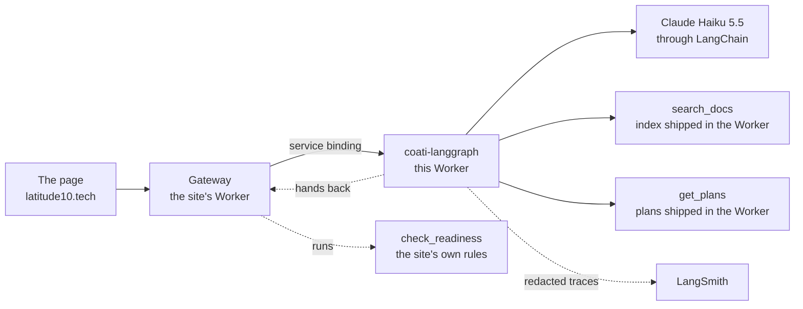

# coati-langgraph

The support agent of [Latitude 10](https://latitude10.tech), rebuilt as a
[LangGraph.js](https://langchain-ai.github.io/langgraphjs/) agent on a
Cloudflare Worker and traced in [LangSmith](https://smith.langchain.com). It is
the second agent in [Latitude 10 Labs](https://latitude10.tech/labs): the same
coati, tools and eval set as
[coati-agent](https://github.com/jorgeortega/coati-agent), the Databricks one,
so the two can be compared side by side.

- **Try it:** [latitude10.tech/labs/langchain-agent](https://latitude10.tech/labs/langchain-agent).
  Ask about the platform, the plans or the docs, or give it the URL of an
  OpenAPI document to score. Each answer shows its sources and how it got there.

## How it works



1. **The site's gateway** validates the question, throttles each visitor and
   meters the month's spend, then calls this Worker through a service binding.
   The Worker has no route and no `workers.dev` URL.
2. **The agent is a `StateGraph`** (`src/graph.ts`) with two nodes, `model`
   and `tools`. After `model`: an answer ends the turn, tool calls go to
   `tools`, an empty answer is asked once more. After `tools`: back to
   `model`, or, for `check_readiness`, the turn ends and goes back to the
   gateway, which runs it and sends the result. At most four model calls.
3. **No checkpointer.** A pending tool ends the run, and the gateway sends the
   whole conversation back with the result, so the Worker keeps no state.
4. **Every turn is traced** in LangSmith, with emails, keys and tokens removed
   first (`src/redact.ts`, LangSmith's `hideInputs`/`hideOutputs`), and sent
   after the answer with `ctx.waitUntil`. LangSmith deletes traces after 14
   days on its free plan. No tool writes anything.

## Results

The 46 cases of coati-agent's eval set, scored by the same Databricks managed
judge (`evals/RESULTS.md` there). Three models ran through this graph:

| | Facts right | Shared 40 | Right page searched | Median time |
|---|---|---|---|---|
| **Claude Haiku 5.5** (served) | 24/30 | 18/24 | 13/16 | 2.4 s |
| gpt-oss-120b (Workers AI) | 22/30 | 17/24 | 9/16 | 3.9 s |
| qwen3-30b-a3b (Workers AI) | 19/30 | 13/24 | 7/16 | 3.2 s |
| coati-agent on Databricks (Qwen3.5 122B) | 24/30 | 18/24 | 12/16 | 3.7 s |

The same cases also run as a LangSmith dataset with the code checks
(`scripts/langsmith-evals.ts`): 46/46 on each check for Claude Haiku 5.5.

## Why it's built this way

- **The graph is written out, not prebuilt.** `createReactAgent` would do it in
  one line; writing the nodes and edges shows the loop and keeps it comparable,
  line by line, with coati-agent's.
- **Same data, same prompt.** The site exports its rules, summary, docs and
  plans with SHA-256 hashes (`data/`); `src/prompt.ts` refuses a copy that
  doesn't match. The tool schemas and the tools note are coati-agent's, word
  for word.
- **Search in memory.** The docs are 72 chunks, chunked exactly as coati-agent
  chunks them and embedded once with Workers AI `bge-m3` into
  `src/index.json`; only the query is embedded per request.
- **The model is a setting** (`COATI_MODEL`): Workers AI models through
  `ChatOpenAI` on Cloudflare's OpenAI-compatible endpoint and an AI Gateway,
  or Claude through `ChatAnthropic`. `@langchain/cloudflare` couldn't be used:
  its chat model has no tool calling and doesn't take a Worker binding.

## Run it

Node 22 or newer.

```bash
npm ci
npm test
cp .dev.vars.example .dev.vars        # COATI_MODEL=fake answers without a model
npx wrangler dev --port 8799
curl -s -X POST localhost:8799/invoke -d '{"messages":[{"role":"user","content":"Which plans include SSO?"}]}'
```

With a real model, set `COATI_MODEL` and its keys in `.dev.vars` (see
`.dev.vars.example`), and `LANGSMITH_API_KEY` to trace. `npm run index`
rebuilds the search index (it needs `wrangler login`, for Workers AI).

## Layout

```
src/graph.ts       the StateGraph, the step cap, the client-tool hand-back
src/tools.ts       the three tools' schemas, get_plans
src/search.ts      chunking, the in-memory index, search_docs
src/model.ts       COATI_MODEL → ChatOpenAI (Workers AI) or ChatAnthropic
src/invoke.ts      POST /invoke: checks, runs a turn, LangSmith tracing
src/redact.ts      what may leave for LangSmith
src/prompt.ts      the system prompt from the hash-checked export
scripts/           the index build, the LangSmith dataset run
docs/NOTES.md      what I learned, task by task
```

## License

MIT
